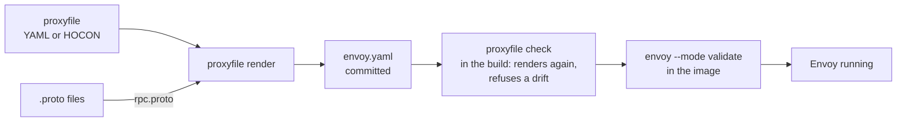

# proxyfile
Generates a proxy's config from a short file. Envoy first.

A proxyfile is a short file, written in YAML or in HOCON, that describes one gateway: the services behind it, the routes
to them, an optional external auth check, the browser origins it admits and, for RPC routes, the methods. You write it
by hand, with a comment beside a value to say why it is there, and the RPC methods can be read from your `.proto` files.
`proxyfile render` turns it into a complete Envoy configuration, written for Envoy 1.40. The same input always gives the
same bytes, so you can commit the generated file and let `proxyfile check` fail a build when someone edits it by hand or
forgets to render.



proxyfile does not run Envoy: an image build can load the committed file with `envoy --mode validate`, as this
repository's [`scripts/validate-envoy.sh`](scripts/validate-envoy.sh) does for the examples.

## Install

Download the release file for your system, check it against the published checksum, and put it on your path.
The release has `proxyfile-linux-amd64`, `proxyfile-linux-arm64`, `proxyfile-darwin-amd64` and
`proxyfile-darwin-arm64`, with `checksums.txt` and `proxyfile.schema.json` beside them.

```sh
curl -fsSLO https://github.com/kitecorp/proxyfile/releases/download/v1.3.0/proxyfile-linux-amd64
curl -fsSLO https://github.com/kitecorp/proxyfile/releases/download/v1.3.0/checksums.txt
shasum -a 256 -c --ignore-missing checksums.txt
install -m 0755 proxyfile-linux-amd64 /usr/local/bin/proxyfile
```

In a Dockerfile, copy the program out of the image. The image holds `/proxyfile` and nothing else.

```dockerfile
COPY --from=ghcr.io/kitecorp/proxyfile:1.3.0 /proxyfile /usr/local/bin/proxyfile
```

With Go installed (the Go version `go.mod` names or newer):

```sh
go install github.com/kitecorp/proxyfile/cmd/proxyfile@v1.3.0
```

## Commands

```
usage: proxyfile render [<file>] -o <envoy.yaml> [--rpc-methods <methods.json>] [--rpc-table <table.json>]
       proxyfile check [<file>] -o <envoy.yaml> [--rpc-methods <methods.json>] [--rpc-table <table.json>]
       proxyfile schema
       proxyfile version
```

- `render` writes the Envoy configuration, and with `--rpc-table` the RPC table, from the proxyfile.
- `check` renders in memory and fails when the files on disk differ, so a build refuses a hand edit or a missed render.
- `schema` prints the JSON Schema of the format.
- `version` prints `proxyfile <version>`.

[docs/commands.md](docs/commands.md) gives the flags, the file names proxyfile looks for, the exit codes and how a
problem is printed.

## The format

A proxyfile is written in YAML or in HOCON, with the same keys in both, and both give the same bytes. A file named
`Proxyfile` or ending in `.conf` is HOCON, and one ending in `.yaml` or `.yml` is YAML. With no file named, proxyfile
reads `Proxyfile`, `proxyfile.conf`, `proxyfile.yaml` or `proxyfile.yml` from the working directory. Only `listen`,
`services`, `origins` and `routes` are required. [docs/format.md](docs/format.md) holds a file with every key but
`tracing` and `services.<name>.address`, and the rules across keys, [docs/hocon.md](docs/hocon.md) the HOCON form, and
[docs/defaults.md](docs/defaults.md) what every gateway gets with no key.

## Keys

Each key's page says what it does and holds a table of every key under it, written from the format description that
the checker and the schema read.

- [`namespace`](docs/listener.md): The namespace of the gateway's own metadata, which the routes and the request log use; proxyfile when not written.
- [`listen`](docs/listener.md): The port of the public listener, on 0.0.0.0.
- [`admin`](docs/listener.md): The port of the admin listener, on 127.0.0.1; no admin listener when not written.
- [`limits`](docs/limits.md): Limits on memory, connections and request headers.
- [`timeouts`](docs/timeouts.md): How long a request, an idle request and an idle connection to a service may last.
- [`services`](docs/services.md): The services behind the gateway, on the same host, by name.
- [`auth`](docs/auth.md): The external check every request goes through before it reaches a service.
- [`remove_from_clients`](docs/listener.md): Headers removed from every client request before routing and before any filter; a name ending in \* is a prefix.
- [`cors`](docs/cors.md): The CORS settings every environment shares.
- [`origins`](docs/origins.md): The browser origins each environment admits, by environment name; or, as in 1.0, the name of an origins file, relative to this file.
- [`routes`](docs/routes.md): The routes, tried in the order written; the rpc entry marks where the RPC routes go.
- [`rpc`](docs/rpc.md): The RPC methods the gateway routes; the routes' rpc entry maps them to services.
- [`log`](docs/log.md): Which requests the request log writes.
- [`tracing`](docs/tracing.md): An X-Ray segment for each sampled request, sent to an agent over UDP.

## Editors

`proxyfile schema` prints the JSON Schema of the format, which gives completion and checking as you type in a YAML
proxyfile. [docs/editors.md](docs/editors.md) says how to point an editor at it, and how to highlight HOCON.

## Licence

Apache-2.0. See [LICENSE](LICENSE).
