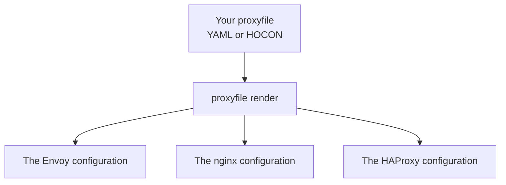
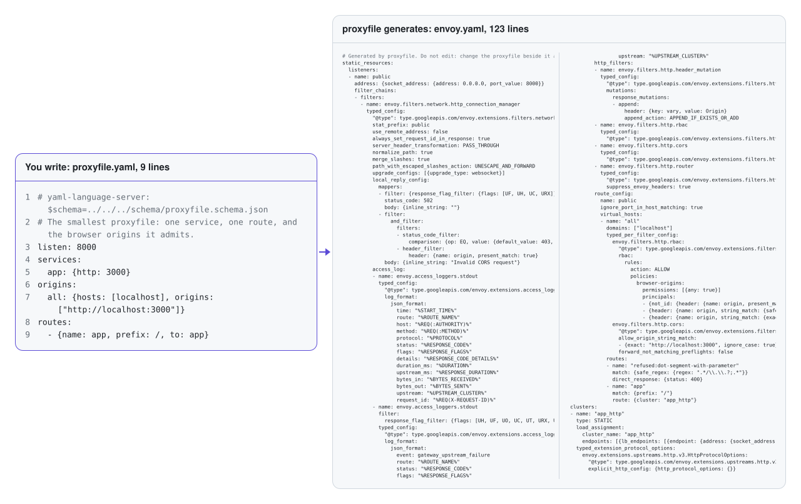
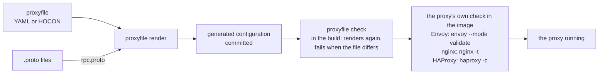

# proxyfile

[](https://github.com/kitecorp/proxyfile/releases/latest)
[](https://github.com/kitecorp/proxyfile/actions/workflows/required.yml)
[](https://pkg.go.dev/github.com/kitecorp/proxyfile/v2)
[](LICENSE)

**One short file, any proxy.**

You describe your gateway in one short file: the services behind it, the routes to them, who may call what. proxyfile
writes the complete configuration of the proxy you run from it.

Generators: Envoy writes every key. nginx and HAProxy write the keys that
[the support table](docs/portability.md#support-by-proxy-from-the-generators) marks supported or partial in their
columns, and each refuses the others by name ([docs/nginx.md](docs/nginx.md), [docs/haproxy.md](docs/haproxy.md)).



<picture>
  <source media="(prefers-color-scheme: dark)" srcset="docs/images/comparison-envoy-dark.svg">
  
</picture>

This is the [minimal example](examples/minimal/yaml/), every line of both files: the 9 lines you write and the 123
lines proxyfile writes for Envoy. For HAProxy it writes [`haproxy.cfg`](examples/minimal/yaml/haproxy.cfg) beside
them, with the script it loads, [`proxyfile.lua`](examples/minimal/yaml/proxyfile.lua), and for nginx
[`nginx.conf`](examples/minimal/yaml/nginx.conf) with [`proxyfile.js`](examples/minimal/yaml/proxyfile.js).

## Why

A proxyfile is written in YAML or in HOCON. You edit the proxyfile and never the generated file, so each value can carry
a comment that says why it is there. For RPC routes, proxyfile reads the methods from your `.proto` files, so you do
not list them by hand. The same input always gives the same bytes, so you commit the generated file. Then
`proxyfile check` fails the build when someone edits that file by hand or forgets to render.

## Quick start

The smallest proxyfile, [`examples/minimal/yaml/proxyfile.yaml`](examples/minimal/yaml/proxyfile.yaml): one service,
one route, and the browser origins it admits.

```yaml
listen: 8000
services:
  app: {http: 3000}
origins:
  all: {hosts: [localhost], origins: ["http://localhost:3000"]}
routes:
  - {name: app, prefix: /, to: app}
```

The same file in HOCON, [`examples/minimal/hocon/Proxyfile`](examples/minimal/hocon/Proxyfile):

```hocon
listen = 8000
services {
  app { http = 3000 }
}
origins {
  all { hosts = [localhost], origins = ["http://localhost:3000"] }
}
routes = [
  { name = app, prefix = /, to = app }
]
```

Save it as `proxyfile.yaml`, or the HOCON form as `Proxyfile` (`render` and `check` read either name when given no
file), and [install proxyfile](#install). Then render it for your proxy, commit what comes out, and let the build
refuse a hand edit or a missed render:

```sh
proxyfile render -o envoy.yaml                    # the default target, envoy: a complete Envoy configuration
proxyfile check -o envoy.yaml                     # in the build: renders again, fails when envoy.yaml differs
proxyfile render --target nginx -o nginx.conf     # routing, CORS, the client's address, header removal, TLS, header
                                                  # limits, idle times, admin paths, the request log, the auth check,
                                                  # rate limits, RPC retries, balance, hash and DNS names, and
                                                  # proxyfile.js beside it; other keys are refused, and a line on
                                                  # standard error counts where it is less strict than Envoy
proxyfile render --target haproxy -o haproxy.cfg  # HAProxy 3.2 or 3.4: routing, TLS, CORS and the auth check; other
                                                  # keys refused by name, and the same line counts where it is less
                                                  # strict than Envoy
```

The `envoy.yaml` it writes has the listener on 8000, a cluster for `app` on 3000, the route and the CORS filter for the
origin; the committed one is [`examples/minimal/yaml/envoy.yaml`](examples/minimal/yaml/envoy.yaml). Beside it each
example commits what the nginx and HAProxy generators write for it, or the refusal render prints when one of them
refuses a key the example writes (`nginx.refused`, `haproxy.refused`). Each generator's column in
[`docs/portability.md`](docs/portability.md#support-by-proxy-from-the-generators) says which keys it writes and what to
write instead of a key it refuses, and [`docs/nginx.md`](docs/nginx.md) and [`docs/haproxy.md`](docs/haproxy.md) say
what each proxy's file does differently from Envoy's. The other directories under [`examples/`](examples/) add
an auth check, a token verified at the proxy, RPC routes read from `.proto` files, tracing, several backends, health
checks, TLS, rate limits and nearly every key, and `examples/portable` holds the keys every generator is to render
alike, which the conformance battery runs on each proxy. Each example keeps each form in a folder of its own, under the
names above and beside the files it renders, so `render` and `check` find the proxyfile in any of them with no file
given.

## Install

Download the release file for your system, check it against the published checksum, and put it on your path.
The release has `proxyfile-linux-amd64`, `proxyfile-linux-arm64`, `proxyfile-darwin-amd64` and
`proxyfile-darwin-arm64`, with `checksums.txt` and `proxyfile.schema.json` beside them.

```sh
curl -fsSLO https://github.com/kitecorp/proxyfile/releases/download/v2.1.0/proxyfile-linux-amd64
curl -fsSLO https://github.com/kitecorp/proxyfile/releases/download/v2.1.0/checksums.txt
shasum -a 256 -c --ignore-missing checksums.txt
install -m 0755 proxyfile-linux-amd64 /usr/local/bin/proxyfile
```

In a Dockerfile, copy the program out of the image. The image holds `/proxyfile` and nothing else.

```dockerfile
COPY --from=ghcr.io/kitecorp/proxyfile:2.1.0 /proxyfile /usr/local/bin/proxyfile
```

With Go installed (the Go version `go.mod` names or newer):

```sh
go install github.com/kitecorp/proxyfile/v2/cmd/proxyfile@v2.1.0
```

## Commands

```
usage: proxyfile render [<file>] -o <output> [--target envoy|nginx|haproxy] [--rpc-methods <methods.json>] [--rpc-table <table.json>]
       proxyfile check [<file>] -o <output> [--target envoy|nginx|haproxy] [--rpc-methods <methods.json>] [--rpc-table <table.json>]
       proxyfile schema
       proxyfile version
```

- `render` writes the proxy's configuration, and with `--rpc-table` the RPC table, from the proxyfile.
- `check` renders in memory and fails when the files on disk differ, so a build refuses a hand edit or a missed render.
- `schema` prints the JSON Schema of the format.
- `version` prints `proxyfile <version>`.

In a build:



proxyfile does not run the proxy. The Envoy generator writes for Envoy 1.40, the nginx generator for nginx 1.30 and
1.31, and the HAProxy generator for HAProxy 3.2 and 3.4, and an image build can load the committed file with
`envoy --mode validate`, `nginx -t` or `haproxy -c`, as this repository's
[`scripts/validate-envoy.sh`](scripts/validate-envoy.sh), [`scripts/validate-nginx.sh`](scripts/validate-nginx.sh)
and [`scripts/validate-haproxy.sh`](scripts/validate-haproxy.sh) do for the examples. The
[conformance battery](docs/conformance.md) runs Envoy on the rendered full and portable examples and on nginx's and
HAProxy's own files, nginx 1.30 and 1.31 on nginx's, and HAProxy 3.2 and 3.4 on HAProxy's, and checks each proxy's
answers to the same requests.

[docs/commands.md](docs/commands.md) gives the flags, the file names proxyfile looks for, the exit codes and how a
problem is printed.

## The format

A proxyfile is written in YAML or in HOCON, with the same keys in both, and both give the same bytes. A file named
`Proxyfile` or ending in `.conf` is HOCON, and one ending in `.yaml` or `.yml` is YAML. With no file named, proxyfile
reads `Proxyfile`, `proxyfile.conf`, `proxyfile.yaml` or `proxyfile.yml` from the working directory. Only `listen`,
`services`, `origins` and `routes` are required. [docs/format.md](docs/format.md) holds a file with every key but
`rpc.proto`, `envoy.tracing`, the `xray` provider, `hash.client` and the `nginx` and `haproxy` blocks, and the rules
across keys, [docs/hocon.md](docs/hocon.md) the HOCON form, and [docs/defaults.md](docs/defaults.md) what the Envoy
generator writes with no key. [docs/portability.md](docs/portability.md) says which keys every proxy can carry and
which belong to Envoy alone, [From 1.x to 2.0](docs/format.md#from-1x-to-20) which keys a 1.x file moves, and
[From 2.0 to 2.1](docs/format.md#from-20-to-21) what 2.1 changes for a 2.0 file.

This README and the pages under `docs/` are also published as a site, at
[kitecorp.github.io/proxyfile](https://kitecorp.github.io/proxyfile/).

## Keys

Each key's page says what it does and holds a table of every key under it, written from the format description that the
checker and the schema read. Each key's class follows its link: `core` for a key every proxy can carry, or the proxy
whose block holds it ([docs/portability.md](docs/portability.md)).

- [`listen`](docs/listener.md) (core): The port of the public listener, on 0.0.0.0.
- [`admin`](docs/listener.md) (core): The port of the admin listener, on 127.0.0.1; no admin listener when not written.
- [`tls`](docs/tls.md) (core): The public listener serves HTTPS with this certificate and key; without it, plain HTTP.
- [`client_address`](docs/listener.md) (core): Which address counts as the client's: forwarded, the last address a proxy in front appended to X-Forwarded-For, or connection, the peer of the TCP connection.
- [`limits`](docs/limits.md) (core): Limits on connections and request headers.
- [`timeouts`](docs/timeouts.md) (core): How long a request, an idle request and an idle connection to a service may last.
- [`services`](docs/services.md) (core): The services behind the gateway, by name.
- [`dns`](docs/services.md) (core): The name lookups of every DNS name the gateway reaches: a service's address, the tracing endpoint and the keys URL's host.
- [`auth`](docs/auth.md) (core): The checks every request goes through before it reaches a service: a service of yours asked about each request, a signed token the proxy verifies, or both.
- [`remove_from_clients`](docs/listener.md) (core): Headers removed from every client request before routing and before any filter; a name ending in \* is a prefix.
- [`cors`](docs/cors.md) (core): The CORS settings every environment shares.
- [`origins`](docs/origins.md) (core): The browser origins each environment admits, by environment name; or, as in 1.0, the name of an origins file, relative to this file.
- [`routes`](docs/routes.md) (core): The routes, tried in the order written; the rpc entry marks where the RPC routes go.
- [`rpc`](docs/rpc.md) (core): The RPC methods the gateway routes; the routes' rpc entry maps them to services.
- [`log`](docs/log.md) (core): Which requests the request log writes.
- [`tracing`](docs/tracing.md) (core): A trace span for each sampled request, sent to AWS X-Ray or to an OpenTelemetry collector.
- [`envoy`](docs/envoy.md) (envoy): The settings only the Envoy generator reads: the namespace of the gateway's metadata, its heap budget, the old place of tracing and the Connect bridge.
- [`nginx`](docs/portability.md) (nginx): The settings only nginx reads beyond the core keys; this version holds none, so the block takes no key.
- [`haproxy`](docs/portability.md) (haproxy): The settings only HAProxy reads beyond the core keys; this version holds none, so the block takes no key.

## Editors

`proxyfile schema` prints the JSON Schema of the format, which gives completion and checking as you type in a YAML
proxyfile. [docs/editors.md](docs/editors.md) says how to point an editor at it, and how to highlight HOCON.

## Made by

proxyfile is made by the team behind [Transferify](https://transferify.eu) ([transferify.ro](https://transferify.ro) in Romania).

## Licence

Apache-2.0. See [LICENSE](LICENSE).
