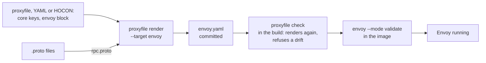

# proxyfile

[](https://github.com/kitecorp/proxyfile/releases/latest)
[](https://github.com/kitecorp/proxyfile/actions/workflows/required.yml)
[](https://pkg.go.dev/github.com/kitecorp/proxyfile/v2)
[](LICENSE)

Generates a proxy's config from a short file. Envoy first.

A proxyfile is a short file, written in YAML or in HOCON, that describes one gateway: the services behind it, the routes
to them, an optional external auth check, the browser origins it admits and, for RPC routes, the methods. You write it
by hand, with a comment beside a value to say why it is there, and the RPC methods can be read from your `.proto` files.
`proxyfile render` turns it into a complete Envoy configuration, written for Envoy 1.40. The same input always gives the
same bytes, so you can commit the generated file and let `proxyfile check` fail a build when someone edits it by hand or
forgets to render.



proxyfile does not run Envoy: an image build can load the committed file with `envoy --mode validate`, as this
repository's [`scripts/validate-envoy.sh`](scripts/validate-envoy.sh) does for the examples.

## Quick start

The smallest proxyfile, [`examples/minimal/gateway.yaml`](examples/minimal/gateway.yaml): one service, one route, and
the browser origins it admits.

```yaml
listen: 8000
services:
  app: {http: 3000}
origins:
  all: {hosts: [localhost], origins: ["http://localhost:3000"]}
routes:
  - {name: app, prefix: /, to: app}
```

The same file in HOCON, [`examples/minimal/gateway.conf`](examples/minimal/gateway.conf):

```hocon
listen = 8000
services {
  app { http = 3000 }
}
origins {
  all { hosts = [localhost], origins = ["http://localhost:3000"] }
}
routes = [
  { name = app, prefix = /, to = app }
]
```

Save it as `proxyfile.yaml`, or the HOCON form as `Proxyfile` (`render` and `check` read either name when given no
file), and [install proxyfile](#install). Then render it for your proxy, commit what comes out, and let the build
refuse a hand edit or a missed render:

```sh
proxyfile render -o envoy.yaml                    # the default target, envoy: a complete Envoy configuration
proxyfile check -o envoy.yaml                     # in the build: renders again, fails when envoy.yaml differs
proxyfile render --target nginx -o nginx.conf     # refused in 2.0: no generator for nginx in this version
proxyfile render --target haproxy -o haproxy.cfg  # refused in 2.0: no generator for haproxy in this version
```

The `envoy.yaml` it writes has the listener on 8000, a cluster for `app` on 3000, the route and the CORS filter for the
origin; the committed one is [`examples/minimal/envoy.yaml`](examples/minimal/envoy.yaml). nginx and HAProxy are the
targets the format reserves ([`docs/portability.md`](docs/portability.md) says which keys each will take); their
generators are [issue 25](https://github.com/kitecorp/proxyfile/issues/25) and
[issue 26](https://github.com/kitecorp/proxyfile/issues/26). The other directories under [`examples/`](examples/) add
an auth check, RPC routes read from `.proto` files, tracing and nearly every key.

## Install

Download the release file for your system, check it against the published checksum, and put it on your path.
The release has `proxyfile-linux-amd64`, `proxyfile-linux-arm64`, `proxyfile-darwin-amd64` and
`proxyfile-darwin-arm64`, with `checksums.txt` and `proxyfile.schema.json` beside them.

```sh
curl -fsSLO https://github.com/kitecorp/proxyfile/releases/download/v2.0.0/proxyfile-linux-amd64
curl -fsSLO https://github.com/kitecorp/proxyfile/releases/download/v2.0.0/checksums.txt
shasum -a 256 -c --ignore-missing checksums.txt
install -m 0755 proxyfile-linux-amd64 /usr/local/bin/proxyfile
```

In a Dockerfile, copy the program out of the image. The image holds `/proxyfile` and nothing else.

```dockerfile
COPY --from=ghcr.io/kitecorp/proxyfile:2.0.0 /proxyfile /usr/local/bin/proxyfile
```

With Go installed (the Go version `go.mod` names or newer):

```sh
go install github.com/kitecorp/proxyfile/v2/cmd/proxyfile@v2.0.0
```

## Commands

```
usage: proxyfile render [<file>] -o <envoy.yaml> [--target envoy] [--rpc-methods <methods.json>] [--rpc-table <table.json>]
       proxyfile check [<file>] -o <envoy.yaml> [--target envoy] [--rpc-methods <methods.json>] [--rpc-table <table.json>]
       proxyfile schema
       proxyfile version
```

- `render` writes the Envoy configuration, and with `--rpc-table` the RPC table, from the proxyfile.
- `check` renders in memory and fails when the files on disk differ, so a build refuses a hand edit or a missed render.
- `schema` prints the JSON Schema of the format.
- `version` prints `proxyfile <version>`.

[docs/commands.md](docs/commands.md) gives the flags, the file names proxyfile looks for, the exit codes and how a
problem is printed.

## The format

A proxyfile is written in YAML or in HOCON, with the same keys in both, and both give the same bytes. A file named
`Proxyfile` or ending in `.conf` is HOCON, and one ending in `.yaml` or `.yml` is YAML. With no file named, proxyfile
reads `Proxyfile`, `proxyfile.conf`, `proxyfile.yaml` or `proxyfile.yml` from the working directory. Only `listen`,
`services`, `origins` and `routes` are required. [docs/format.md](docs/format.md) holds a file with every key but
`envoy.tracing`, `services.<name>.address`, `rpc.proto` and the `nginx` and `haproxy` blocks, and the rules across keys,
[docs/hocon.md](docs/hocon.md) the HOCON form, and [docs/defaults.md](docs/defaults.md) what every gateway gets with no
key. [docs/portability.md](docs/portability.md) says which keys every proxy can carry and which belong to Envoy alone,
and [From 1.x to 2.0](docs/format.md#from-1x-to-20) which keys a 1.x file moves.

## Keys

Each key's page says what it does and holds a table of every key under it, written from the format description that the
checker and the schema read. Each key's class follows its link: `core` for a key every proxy can carry, or the proxy
whose block holds it ([docs/portability.md](docs/portability.md)).

- [`listen`](docs/listener.md) (core): The port of the public listener, on 0.0.0.0.
- [`admin`](docs/listener.md) (core): The port of the admin listener, on 127.0.0.1; no admin listener when not written.
- [`limits`](docs/limits.md) (core): Limits on connections and request headers.
- [`timeouts`](docs/timeouts.md) (core): How long a request, an idle request and an idle connection to a service may last.
- [`services`](docs/services.md) (core): The services behind the gateway, on the same host, by name.
- [`auth`](docs/auth.md) (core): The external check every request goes through before it reaches a service.
- [`remove_from_clients`](docs/listener.md) (core): Headers removed from every client request before routing and before any filter; a name ending in \* is a prefix.
- [`cors`](docs/cors.md) (core): The CORS settings every environment shares.
- [`origins`](docs/origins.md) (core): The browser origins each environment admits, by environment name; or, as in 1.0, the name of an origins file, relative to this file.
- [`routes`](docs/routes.md) (core): The routes, tried in the order written; the rpc entry marks where the RPC routes go.
- [`rpc`](docs/rpc.md) (core): The RPC methods the gateway routes; the routes' rpc entry maps them to services.
- [`log`](docs/log.md) (core): Which requests the request log writes.
- [`envoy`](docs/envoy.md) (envoy): The settings only the Envoy generator reads: the namespace of the gateway's metadata, its heap budget, X-Ray tracing and the Connect bridge.
- [`nginx`](docs/portability.md) (nginx): The settings only nginx will read; this version has no nginx generator, so it takes no key.
- [`haproxy`](docs/portability.md) (haproxy): The settings only HAProxy will read; this version has no HAProxy generator, so it takes no key.

## Editors

`proxyfile schema` prints the JSON Schema of the format, which gives completion and checking as you type in a YAML
proxyfile. [docs/editors.md](docs/editors.md) says how to point an editor at it, and how to highlight HOCON.

## Licence

Apache-2.0. See [LICENSE](LICENSE).
